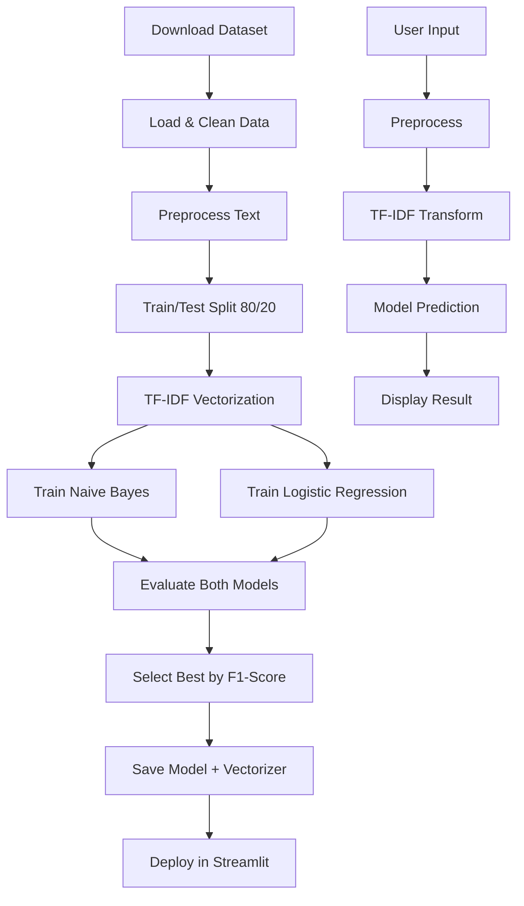

# 📧 Email Spam Detector

> An NLP + Machine Learning application that classifies SMS/email messages as **SPAM** or **HAM** using TF-IDF features and classical ML models.


---

## 📖 Project Overview

This application demonstrates traditional machine learning approaches to text classification. It trains two models (Multinomial Naive Bayes and Logistic Regression) on the UCI SMS Spam Collection dataset, compares their performance, and deploys the best one in an interactive web interface.

## 🎯 Problem Statement

Spam detection is a critical NLP classification task. This project demonstrates:
- Text preprocessing for NLP
- Feature extraction with TF-IDF
- Model training and comparison
- Evaluation with multiple metrics
- Feature importance analysis

## 🏆 Objectives

1. Build a spam classifier using classical ML (not deep learning).
2. Implement a complete NLP preprocessing pipeline.
3. Train and compare two models with proper evaluation.
4. Provide an interactive UI for single and batch classification.
5. Include model explainability through feature importance.

## ✨ Key Features

| Feature | Description |
|---------|-------------|
| **Single Message Classification** | Enter a message and get spam/ham prediction with probability |
| **Batch CSV Processing** | Upload CSV for bulk classification |
| **Model Evaluation Dashboard** | Accuracy, precision, recall, F1, confusion matrix, classification report |
| **Model Comparison** | Side-by-side comparison of Naive Bayes vs Logistic Regression |
| **Feature Importance** | Top spam-indicating words with weights |
| **Automatic Dataset Download** | Dataset fetched from UCI on first run |
| **Professional UI** | Clean dashboard with visualizations |

## 🛠️ Technologies Used

- **Python 3.10+** — Primary language
- **Streamlit** — Web UI framework
- **Scikit-learn** — ML models, TF-IDF, evaluation
- **NLTK** — Stopword removal
- **Pandas** — Data handling
- **NumPy** — Numerical operations
- **Matplotlib + Seaborn** — Visualizations
- **joblib** — Model persistence
- **requests** — Dataset download

## 🧠 Model Architecture and Methodology

### Feature Extraction: TF-IDF Vectorization

| Parameter | Value |
|-----------|-------|
| Max features | 5,000 |
| N-gram range | (1, 2) — unigrams + bigrams |
| Min document frequency | 2 |
| Max document frequency | 0.95 |
| Fitted on | Training data only (no leakage) |

### Models Trained

1. **Multinomial Naive Bayes** (`alpha=1.0`)
   - Probabilistic classifier based on Bayes' theorem
   - Assumes feature independence
   - Fast training and inference
   - Well-suited for text classification

2. **Logistic Regression** (`solver='liblinear'`, `max_iter=1000`)
   - Linear classifier with L2 regularization
   - Provides interpretable coefficients
   - Good baseline for binary classification

### Model Selection

The best model is selected by **F1-score** on the test set, which balances precision and recall — important for imbalanced spam datasets.

### Preprocessing Pipeline

```
Raw Text → Lowercase → URL/Email/Phone/Currency Replacement → Punctuation Removal
→ Digit Removal → Stopword Removal → Whitespace Normalization → Clean Text
```

**Preprocessing steps explained:**
1. **Lowercasing:** Ensures "FREE" and "free" are treated identically.
2. **URL/Email/Phone replacement:** Replaces with tokens (URLTOKEN, EMAILTOKEN, etc.) to preserve the signal that these elements are present without being distracted by specific URLs.
3. **Punctuation removal:** Strips all punctuation for cleaner tokenization.
4. **Digit removal:** Replaces standalone numbers with NUMBERTOKEN.
5. **Stopword removal:** Removes common English words (the, is, at, etc.) that don't contribute to spam detection.
6. **Whitespace normalization:** Collapses multiple spaces into single spaces.

## 📊 Dataset Information

**UCI SMS Spam Collection Dataset**

| Property | Value |
|----------|-------|
| Source | [UCI ML Repository](https://archive.ics.uci.edu/ml/datasets/SMS+Spam+Collection) |
| Total messages | ~5,574 |
| Spam messages | ~747 (13.4%) |
| Ham messages | ~4,827 (86.6%) |
| Format | Tab-separated (label, message) |
| License | Free for research use |

The dataset is downloaded automatically on first run. If the download fails (e.g., no internet), a bundled sample dataset is used as fallback.

## 🔄 Workflow Diagram



## 📁 Project Structure

```
email-spam-detector/
├── app.py                      # Main Streamlit application
├── requirements.txt
├── README.md
├── .gitignore
├── src/
│   ├── __init__.py
│   ├── data_loader.py          # Dataset download and loading
│   ├── preprocessing.py        # Text cleaning and validation
│   └── model_trainer.py        # Training, evaluation, prediction
├── models/
│   └── .gitkeep               # Trained models (generated at runtime)
├── data/
│   └── .gitkeep               # Dataset (downloaded at runtime)
├── utils/
│   ├── __init__.py
│   ├── visualization.py       # Matplotlib/Seaborn charts
│   └── csv_handler.py         # Batch CSV processing
├── tests/
│   ├── __init__.py
│   └── test_spam_detector.py   # Test suite
└── .streamlit/
    └── config.toml
```

## 🚀 Installation Instructions

```bash
git clone https://github.com/Sawaira-saeed/email-spam-detector.git
cd email-spam-detector

python -m venv .venv
# Windows: .venv\Scripts\activate
# macOS/Linux: source .venv/bin/activate

pip install -r requirements.txt
```

## 🖥️ Local Execution Instructions

```bash
streamlit run app.py
```

The application will:
1. Download the UCI SMS Spam dataset (first run only)
2. Train both models (~5 seconds)
3. Open at `http://localhost:8501`

## 🤗 Hugging Face Deployment Instructions

1. Create a new Space at [huggingface.co/new-space](https://huggingface.co/new-space)
   - Name: `email-spam-detector`
   - SDK: **Streamlit**
   - Hardware: CPU (free tier)

2. Clone the Space and copy project files:
   ```bash
   git clone https://huggingface.co/spaces/Sawaira-saeed/email-spam-detector
   # Copy all project files (except .venv/ and tests/)
   git add . && git commit -m "Deploy" && git push
   ```

3. Access at `https://Sawaira-saeed-email-spam-detector.hf.space`

## 📝 Sample Input and Output

### Sample Input (Spam)
```
CONGRATULATIONS! You have been selected as the winner of a $1,000
Walmart gift card. Reply with CLAIM to claim your prize.
```

### Sample Output
```
🚫 SPAM
Confidence: 98.5%

Spam Probability: 98.5%
Ham Probability:  1.5%
```

### Sample Input (Ham)
```
Hey, are we still on for dinner tonight? Let me know what time works.
```

### Sample Output
```
✅ HAM
Confidence: 92.3%

Spam Probability:  7.7%
Ham Probability: 92.3%
```

## 📸 Screenshots

Run `streamlit run app.py` and capture:
- `classify.png` — Single message classification
- `batch.png` — Batch CSV processing
- `evaluation.png` — Model evaluation dashboard

## ⚠️ Limitations

1. **SMS-focused:** The model is trained on SMS messages, not full emails. Long emails may not classify accurately.
2. **English only:** Stopwords and preprocessing are English-specific.
3. **Class imbalance:** The dataset is ~87% ham, which affects model behavior.
4. **No deep learning:** This project intentionally uses classical ML for comparison with transformer-based approaches.
5. **Static model:** The model is trained at startup; it doesn't learn from new input.
6. **Feature importance is statistical:** Top words indicate correlation, not causation.

## 🔮 Future Improvements

1. **Full email support:** Parse email headers and body for better classification.
2. **Deep learning model:** Add a BERT-based classifier for comparison.
3. **Online learning:** Update the model with user feedback.
4. **Multi-language:** Support non-English messages.
5. **Adversarial robustness:** Test against obfuscated spam (e.g., "FR EE" instead of "FREE").

## 👤 Author

**AI-NLP-Portfolio** — Built for professional AI/ML portfolio showcase.

---

*Dataset: [UCI SMS Spam Collection](https://archive.ics.uci.edu/ml/datasets/SMS+Spam+Collection)*